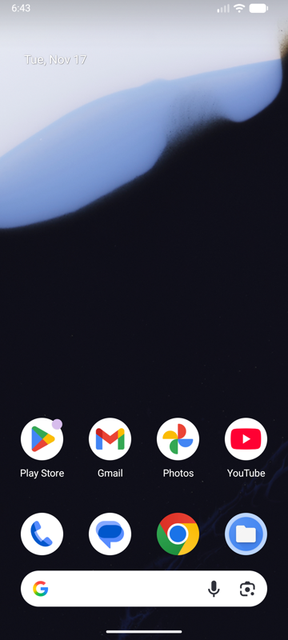
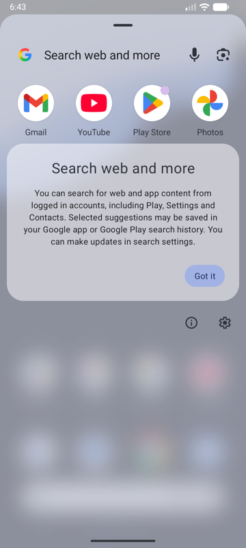
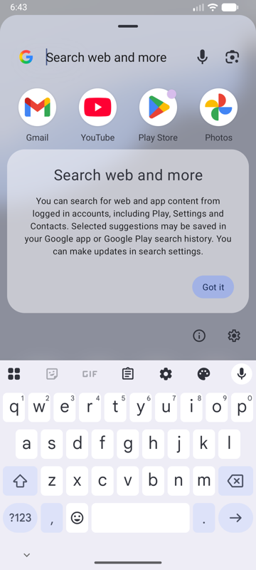
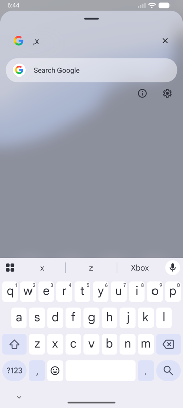
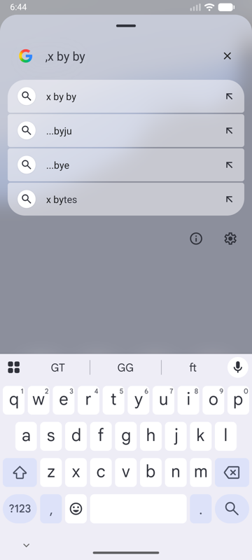

# Project overview

This is an Android music app built on [Myspoti / Orpheon](https://github.com/kota-zo/myspoti) (GPL-3.0). It is written in Kotlin with Jetpack Compose. The app has one engine and two complete interfaces ("looks") that the user switches between in Settings.

- **Classic**: follows the familiar Spotify mobile layout (dark, green accent, list-first).
- **Immersive**: the app's own glass design, loosely inspired by Apple Music: blurred cover colours, floating tab bar, large type, glass sheets.

Screenshots of both looks:

| Classic | Classic player | Immersive home | Immersive player |
|---|---|---|---|
|  |  |  |  |

Recent Immersive captures from the emulator (360×800):

| Home | Library | Search | Player | Player, scrolled |
|---|---|---|---|---|
|  |  |  |  |  |

More shots: `docs/screenshots/` (album, artist), and the `shot-*.png` files in the repo root.

---

## Repository layout

```
/                    repo root (git)
├─ base/             the Android Gradle project (everything that builds)
├─ docs/             API notes, extension guide, screenshots, this file
├─ tools/            release helpers (tag check, etc.)
├─ README.md         user-facing readme + "For developers"
└─ THIRD_PARTY_NOTICES.md, LICENSE, AGENTS.md, CLAUDE.md
```

### Gradle modules (`base/settings.gradle.kts`)

| Module | What it is |
|---|---|
| `:app` | The Compose UI (both looks), view models, playback glue, downloads, settings. Package `com.music.spotui`. |
| `:api` | Plain-Kotlin contract the UI talks to: models and interfaces for player, search, catalog, library, playlists, home, podcasts, users, lyrics, devices, Jam. |
| `:api-spotify` | Implements `:api` on Spotify's Web Player: GraphQL/web endpoints for catalog, search, library. `SpotifyContent.kt` turns JSON into models. |
| `:host-android` | The hidden WebView that runs the official Web Player, the bridge script that drives it, the media session / notification / Android Auto service. |
| `:host-cdp` | Same API driven over desktop Chrome DevTools; used for live API tests without a phone. |
| `:api-ytmusic` | YouTube Music provider. `YtmPlayer` runs the official music.youtube.com page in a hidden WebView; `src/main/resources/ytmusic/ytm-page.js` is the bridge (state, next item, controls). |
| `:api-web` | Shared web helpers. |
| `:catalog` | Catalog/metadata layer used when the account provider isn't Spotify (matching, metadata order). |
| `:extensions` | Sandbox that third-party extension scripts run in (manifest, permissions, catalogue). Plain JVM. |
| `:extensions-cli` | Desktop runner for extensions. |
| `:engine`, `:engine-android` | Local audio engine pieces (ExoPlayer side, processors). |
| `:automix` | Track transitions / crossfade analysis. |
| `:wear` | Wear OS companion. |
| `:pass` | Supporter pass / licence checks. |

Further reading: `base/api-spotify/README.md`, `docs/api/*.md` (one file per area: SEARCH-HOME, LIBRARY, CATALOG, JAM, SESSION, NATIVE-PLAYBACK …), `docs/extensions/*.md` (API, GUIDE, SOURCE-PIPELINES, UI-LOOKS).

---

## Inside `:app` (`base/app/src/main/java/com/music/spotui`)

```
App.kt                 Application class; starts the runtime, Graph, notices
di/                    long-lived singletons (the "engine room")
data/                  API wrappers, caches, prefs, offline, local files
  api/                   Api.kt, ProfileCache, ScreenCache, PagePrefetch, Lyrics*, SpotifySync …
  offline/               downloads + encrypted offline store
  local/                 device music, local playlists, listen history
  preferences/           every user setting (LookPref, AccountProviderPref, QualityPref …)
  entity/                UI models (SongsModel, AlbumsModel, ArtistsModel …)
extensions/            app side of the extension system (registry, store, audio, auth, hooks)
ui/
  navigation/            Routes.kt, MyNavHost.kt, MainBottomNavigation.kt, PlayerSheet.kt
  screens/               Classic screens
  immersive/             Immersive look (own screens, player, shell, sheets)
  components/            shared widgets used by both looks
  look/                  look switching, previews, lyric line renderers, mesh gradient
  design/, theme/        icons (AppIcons), colours, typography
  viewmodel/, repository/
podcast/ radio/ video/ cast/ connect/ widget/ wear/ automix/ cli/
```

### `di/` — playback and state

| File | Role |
|---|---|
| `SongPlayer.kt` | The one object the UI calls: `play`, `pause`, `next`, `seek`, queue, like. Exposes `nowPlaying` (current song, position, `next`, repeat, shuffle) as state. Routes each command to the right backend. |
| `LocalPlayer.kt` | ExoPlayer for anything not played by a web page: extension streams, downloaded files, device files. |
| `YtmPlayback.kt`, `YtmRuntime.kt` | Glue between `SongPlayer` and the YouTube Music page player. |
| `CurrentSongState.kt`, `Palette.kt` | Current song + colours extracted from the cover (drives backgrounds in both looks). |
| `LibraryState.kt`, `AccountSync.kt`, `AccountApi.kt` | Library cache and account switching. |
| `Haptics.kt` | All haptic feedback (`tick`, `click`, `confirm`, `thud`). |
| `Graph.kt` | Simple service locator. |
| `CrossfadeRamp`, `EqualizerProcessor`, `SpatialProcessor`, `NoisyAudio`, `CallPause` … | audio details. |

### How a song plays

There are three playback paths. `SongPlayer` decides which one per song.

```
                     ┌──────────────────────── SongPlayer ────────────────────────┐
UI (both looks) ───▶ │ play / pause / next / seek / like / queue                   │
                     └─────┬───────────────────────┬───────────────────────┬───────┘
                           │                       │                       │
              Spotify account          YouTube Music account      extension / download / device file
                           │                       │                       │
           :host-android WebView       :api-ytmusic YtmPlayer       LocalPlayer (ExoPlayer)
           official Web Player         official YTM web page        ExtStreamCache, OfflineStore
           + bridge script             + ytm-page.js bridge         MediaDataSource
                           │                       │                       │
                           └──────────── PlayerState / nowPlaying ─────────┘
                                               │
                         media session + notification (host-android service)
```

- **Spotify**: the official Web Player runs in a hidden WebView; a bridge script reads its state and presses its controls. Catalog/search/library calls go straight to Spotify's web endpoints via `:api-spotify`.
- **YouTube Music**: same idea with music.youtube.com. `ytm-page.js` reports `state()` (track, position, playing, and `next` read from the page's queue) back to `YtmPlayer.read()`, which builds a `PlayerState` with `next` filled in.
- **Extensions / offline / local files**: `LocalPlayer` (ExoPlayer). An extension that offers a stream hands over a URL; `ExtStreamCache` caches it and pre-fetches the next song. Downloaded songs play from the encrypted offline store.

`AccountProviderPref` holds which provider is active (Spotify or YouTube Music). Several accounts can be signed in; only the active provider's account is "in use" (see `ui/components/AccountsList.kt`).

### Downloads and offline (`data/offline/`)

| File | Role |
|---|---|
| `OfflineDownloader.kt` | Asks download-source extensions for files (best first), checks the length, encrypts with `OfflineCrypto`, stores in `OfflineStore`. |
| `OfflineCollections.kt` | Keeps downloaded playlists/albums in sync as they change. |
| `ExtStreamCache.kt` | Caches extension streams; caches the next song ahead. |
| `LocalPlayPlan.kt` | Decides what file/stream `LocalPlayer` uses for a song. |
| `DashLive`, `DashFlacRemux`, `AacTranscoder`, `StreamHead`, `InterruptibleHttp` | format and network helpers. |
| `PodcastDownloader.kt` | Podcast episodes. |

UI: `ui/screens/DownloadsScreen.kt`, `ui/immersive/pages/ImmersiveDownloadsScreen.kt`, `ui/components/DownloadBadge.kt`, `DownloadPref`.

### Extensions

Third-party scripts installed by the user from the in-app store. Engine in `:extensions`, app side in `app/.../extensions/` (`ExtensionRegistry`, `ExtensionStore`, `ExtensionAudio`, `ExtensionAuth`, `HookDispatch`, `MediaDataSource`). They can supply search results, streams, download sources, lyrics, and UI hooks. Spec: `docs/extensions/API.md`, `GUIDE.md`, `SOURCE-PIPELINES.md`.

### Caching

- `ScreenCache` keeps the last result of each screen so pages open instantly, then refreshes.
- `PagePrefetch` loads a page's data on press-down / when a row scrolls near, before navigation.
- `ProfileCache` caches the user profile (retries `users.me()` a few times at start).
- Glide handles images (`DataSaverGlide` lowers sizes on data saver).

---

## Navigation and pages

`ui/navigation/MyNavHost.kt` is the single NavHost. Every route picks the Classic or Immersive screen with `isImmersive()`:

```kotlin
composable(Routes.Home.route) {
    if (isImmersive()) ImmersiveHomeScreen(nav) else HomeScreen(nav)
}
```

The full player is **not** a route for normal use: it is a sheet over everything (`PlayerSheet.kt`, `PlayerSheet.open`) that slides up from the mini player. Swiping down closes it.

### Tabs

Home · Search · Library (plus Friends where enabled). Classic uses `MainBottomNavigation.kt`; Immersive uses the floating glass bar in `ui/immersive/shell/FloatingTabBar.kt` / `ImmersiveTabBar.kt`. Re-tapping a tab scrolls to top (`TabReselect`).

### Routes (`Routes.kt`)

| Route | Classic screen | Immersive screen |
|---|---|---|
| `home` | `screens/HomeScreen.kt` | `immersive/screens/ImmersiveHomeScreen` |
| `search` | `SearchScreen.kt` | `ImmersiveSearchScreen` |
| `library` | `LibraryScreeen.kt` | `ImmersiveLibraryScreen` |
| `album`, `playlist`, `liked` | `ContextScreen.kt`, `AlbumByIdScreen.kt` | `immersive/screens/ImmersiveAlbumByIdScreen`, `ImmersivePage` |
| `artist`, `artistreleases`, `liked_by_artist` | `ArtistScreen.kt` | `ImmersiveArtistScreen`, `ImmersiveArtistReleasesScreen` |
| `show`, `episode`, `episodes`, `newepisodes` | `ShowScreen.kt`, `EpisodeScreen.kt` | `immersive/podcast/*` |
| `queue` | `QueueScreen.kt` | `ImmersiveQueueScreen` |
| `downloads` | `DownloadsScreen.kt` | `ImmersiveDownloadsScreen` |
| `localfiles`, `localplaylist`, `folder` | `LocalFilesScreen.kt` | `ImmersiveLibraryPages` |
| `category`, `newreleases` | `CategoryScreen.kt`, `DiscoverScreens.kt` | `ImmersiveDiscoverScreens` |
| `recent`, `recap` | `RecentlyPlayedScreen.kt`, `StatsScreens.kt` | `ImmersiveRecentlyPlayedScreen`, `ImmersiveActivityScreens` |
| `profile`, `friends` | `ProfileScreen.kt`, `FollowListScreen.kt` | `immersive/people/*` |
| `settings` | `SettingsScreen.kt` | `ImmersiveSettingsScreen` |
| `extensions`, `extension`, `extension-store` | `ExtensionsScreen.kt`, `ExtensionDetail.kt`, `ExtensionPage.kt` | `ImmersiveExtensionsScreen`, `ImmersiveExtensionDetail` |
| `equalizer`, `hiddensongs`, `whatsnew`, `liveradio` | matching `*Screen.kt` | matching `Immersive*Screen` |

First launch: `WelcomeScreen` → `Onboarding` / `SetupScreen` (pick provider, sign in, pick look) → Home.

### The player

**Classic** — `ui/screens/PlayerScreen.kt`
- Vertical page: cover / canvas video at top, title + artist + like, seek bar, transport, then cards below (lyrics preview, artist, credits — `ClassicInfoCards.kt`).
- When scrolled past the cover a compact bar (`ClassicScrolledBar`) shows title, like and play/pause.
- Lyrics (`LyricsScreen.kt`) and queue (`QueueScreen.kt` / `SongQueue.kt`) open as full overlays.

**Immersive** — `ui/immersive/player/`
- `ImmersivePlayer.kt`: the whole sheet. Blurred cover/palette background, big cover or canvas video, credits (title/artist), live lyric line above the title, video pill, controls (`PlayerControls.kt`, `PlayerControlsBlock`), scrollable info below (`ImmersiveInfoPanel.kt`). When scrolled, a floating rounded header (`ScrolledHeader`) appears.
- Panels inside the sheet: lyrics (`immersive/lyrics/ImmersiveLyricsPanel.kt`) and queue (`ImmersiveQueuePanel.kt`, with history, drag reorder, sleep timer in its header). While the queue is open the controls shrink (`QUEUE_CONTROLS_SCALE`).
- `PlayerBridge.kt` connects `SongPlayer` state to the UI and builds `ImmersivePlayerActions` (like, next, open artist …).
- `ImmersiveMiniPlayer.kt` and `ImmersivePlayerOverlay.kt`: mini player and the sheet container.

### Shared overlays and sheets

- `ui/components/AppNotice.kt`: the app's own toast (glass pill with cover + badge, one optional action). `AppNoticeHost()` is placed once over the whole app.
- Song menu: `components/SongOptionsSheet.kt` (Classic), `immersive/sheets/ImmersiveSongOptionsSheet.kt` (Immersive).
- `AddToPlaylistSheet`, `SavedInSheet`, `ShareCardSheet`, `LookSheet`, `SourcePicker`, `AboutSheet`.
- Profile drawer: `ProfileSheet` (in `HomeScreen.kt`), opened from the avatar on Home and Library.

---

## Data flow, one tap end to end

Example: user taps a song in a playlist.

1. Row `onClick` in the screen → `SongPlayer.play(song, context)`.
2. `SongPlayer` checks the provider / whether the song is downloaded / which extension owns it, and sends the command to the WebView bridge, `YtmPlayer`, or `LocalPlayer`.
3. The backend reports state back → `SongPlayer.nowPlaying` updates (song, position, `next`).
4. `CurrentSongState` + `Palette` update; mini player, full player, notification and widget recompose from that state.
5. Side tasks start: lyrics prefetch for current + next, `ExtStreamCache` prefetch of the next stream, listen history.

Like/save: `SongPlayer.toggleLike` → `LibraryEdits` / `LibraryOutbox` (queues writes and retries if offline) → `AppNotice` shows the result.

---

## Settings and preferences

All in `data/preferences/`. The main ones:

- `LookPref` — Classic or Immersive (`isImmersive()`).
- `AccountProviderPref` — Spotify or YouTube Music.
- `QualityPref`, `DownloadPref`, `DataSaver` — audio and download quality.
- `AppearancePref`, `SettingsPref`, `EqualizerPref`, `SponsorBlockPref`, `LocalFilesPref`, `HiddenSongs`, `LastSession`.

Strings live in `base/app/src/main/res/values*/` (several languages; English in `values/`).

---

## Build and run

Requirements: JDK 17+ (Android Studio's bundled JBR works), Android SDK with compileSdk 37.

```bash
cd base
./gradlew :app:assembleDebug -Pabis=x86_64,arm64-v8a
./gradlew testDebugUnitTest
```

- `-Pabis` limits native libraries to the listed ABIs (smaller APK, faster build). Use `x86_64` for the emulator and `arm64-v8a` for phones.
- Debug application id: `app.orpheon.beta.dev`.
- Install / launch:

```bash
adb install -r base/app/build/outputs/apk/debug/app-debug.apk
adb shell monkey -p app.orpheon.beta.dev -c android.intent.category.LAUNCHER 1
```

- Live API tests against desktop Chrome: see README "For developers" (`:host-cdp:test -Pcdp=http://localhost:9222`).
- CI: GitHub Actions builds every push; `vX.Y.Z` tags publish releases (`tools/check_tag.py`).

---

## Current state

Branch `glass/full-player`. Recent work (see `git log`):

- Immersive player: floating scrolled header, live lyric line animation, video pill placement, title hierarchy, compact controls while the queue is open, queue history and sleep timer in the queue header.
- Classic player: scrolled compact bar, video pill above the title.
- Verified badge on artists, star icon for like everywhere, profile avatar on Home and Library, account "in use" state.
- YouTube Music: next song read from the page's queue so the "up next" hint and lyrics prefetch work.

Known open items:

- Song changes on the YouTube Music path take 2–3 s (the web page loads the next video). Spotify is fast.
- A like right after launch can fail with "Could not update your library".
- The notification sometimes shows an older song (seen once; possibly another device controlling playback).
- Startup can stutter while the WebView is created eagerly in the runtime start.
- Not yet checked on a device: Classic scrolled bar, YouTube Music "up next".
